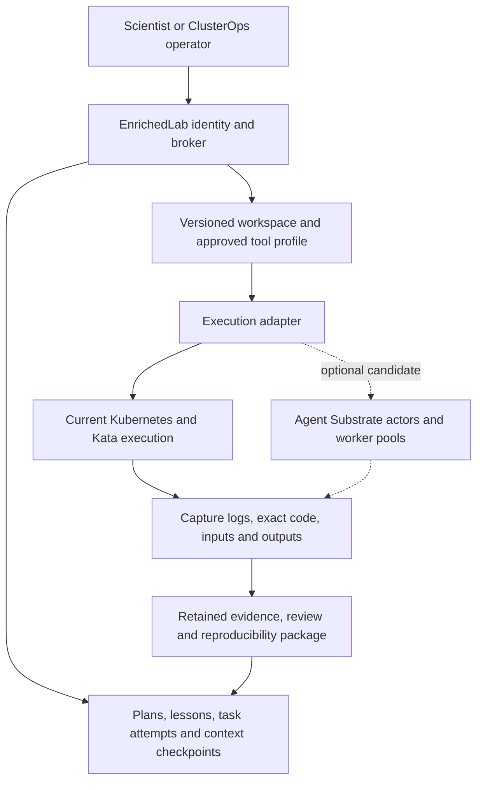

# Google AX integration review

This is a source assessment and implementation plan for the upstream revisions listed below. AX and Agent Substrate
were not installed or accepted as execution backends. The implementation decisions below add the agent/runtime
distinction, shared-project authorization, repository ownership, concurrency and per-use-case decision calibration. They are planned work, not shipped features.

## Decision

Keep EnrichedLab's broker, scientific records, agent state and scientist interface. Adopt AX's separation of a
declared workspace from its disposable compute. Evaluate Agent Substrate separately as an optional execution
backend when idle-session cost or activation latency warrants it. Do not migrate the research system into AX or
maintain a broad AX fork now.

AX is useful infrastructure research. It does not replace long-horizon planning, context management, evidence
retention, scientific validation, tenant authorization or ClusterOps action control. A process snapshot is not an
agent's research memory. Those records must survive a runtime change and remain understandable without the model.

The first implementation should be **a resumable research workspace with an explicit preparation receipt** on the
existing broker path. This delivers value without first introducing Redis and a second runtime control plane.
It also gives a later Substrate adapter a small, owned contract to satisfy.

## Reviewed revisions and scope

| Component | Reviewed coordinate | Status |
|---|---|---|
| [Google AX][ax] | v0.3.0, `d8ed0fe38bceb7842d3c47817d53d16ccdfcb601` | Latest release and main head observed September 22; release published September 20. Apache-2.0; pre-1.0 with breaking-change warning. |
| [Agent Substrate][substrate] | `672533541dbfcd29084e4de2475267088bda3651` | Exact AX dependency. Apache-2.0; upstream warns that it is early and not production-ready. |
| Substrate upstream activity | `d0d85c397db77dee84f3c87f1b23cb10a714f3b5` | Main head observed September 22. Newer than AX's dependency; activity checked, not substituted into the reviewed AX build. |

All 62 tracked AX files were inventoried: API definitions, generated bindings, server and controller, both stores,
workspace preparation and planner, model client, runner, guest/tunnel clients, CLI, tests, deployment/build/CI,
documentation, examples, license and assets. Review followed the handwritten execution paths and their contracts.
Generated bindings were checked through the source protobuf and callers, not audited line by line; branding assets
and dependency checksum lines are not execution reviews. Substrate review covered the dependency's runtime,
snapshot, identity, storage, installation and telemetry interfaces. This is not an exhaustive dependency security
audit or a cluster performance result.

## What AX supplies

AX's [design][design] has four binaries: a CLI, gRPC API, reconciliation controller and in-container task runner.
Its YAML resources are Task, Workspace, Gateway and Model. They are stored in Redis, not Kubernetes CRDs. Redis
Streams carry reconciliation work to controllers; Agent Substrate creates and resumes the sandbox actors.

The useful split is:

Substrate's actor is a logical execution instance; a worker is the compute hosting it. Warm workers and activation
routing can let many idle actors share fewer running workers. That is promising for agents waiting on tools,
scientists or events. It is not proof of useful density for memory-heavy R jobs, GPU work or this installation.
The [architecture document][substrate_arch] itself distinguishes aspirational targets from implementation.

## Source findings that change the integration choice

| Boundary | Observed behavior at the reviewed revision | EnrichedLab consequence |
|---|---|---|
| API identity | AX constructs a plain gRPC server without caller-auth interceptors. Its CLI uses insecure transport even after stripping an HTTPS prefix. Atespace is caller supplied. [Server][server], [CLI][cli]. | Do not expose AX directly to scientists or agents. Broker authorization must cover every operation and object. A namespace-like name is not a tenant boundary. |
| Downstream identity | AX authenticates its Substrate connection separately. Substrate supports mTLS/JWT but explicitly says authorization/RBAC is not implemented and authenticated providers can control the control plane. [Authentication][auth]. | A service identity behind the broker is a possible candidate boundary; end-user OIDC acceptance alone is insufficient. Research and ClusterOps identities remain separate. |
| Network policy | Missing gateway restrictions default to wildcard egress. Policy-application errors are logged and execution continues. Empty allowlists return without installing a policy; HostRule ports are not translated. [Reconciler][reconciler], [Substrate client][client]. | Our deny-egress contract cannot be inherited from these defaults. Admission must fail when the requested policy is absent or unenforced. |
| Runtime and resources | AX's template builder selects `gvisor-default`. Declared task CPU/memory values are not passed into that builder. Underlying Substrate also has a Kata/Cloud Hypervisor microVM runtime. [Client][client], [API][proto], [microVM guide][microvm]. | Existing `kata-clh` placement, resource admission and GPU profiles are not plug-in settings for this AX implementation. Worker limits and per-task resource enforcement are different claims. |
| Workspace preparation | Missing workspace references are skipped. Setup creates a skills directory but does not fetch registry skills or materialize the advertised MCP configuration. Several missing-tool/bootstrap failures log and continue. [Worker][worker], [Setup][setup]. | A successful readiness response must be bound to a deterministic preparation receipt, required files and approved tool capabilities. |
| Workspace persistence | AX declares `/workspace` durable, while initialization markers default to `/ax`. Re-preparation performs a forced checkout. [Setup][setup], [Client][client]. | Source-derived resume risk: do not rely on an ephemeral marker to protect modified work or moving Git references. This was not a measured snapshot-loss incident. |
| Resume meaning | AX configures DATA snapshots and GOLDEN resume. Substrate defines GOLDEN as the template's guest state combined with the actor's own durable data. [Runner contract][runner_doc], [Snapshot API][snapshot_api]. | This is not restoration of the task's last running process state. It does not inherently discard durable workspace data either. Plans, lessons and completed actions still need explicit checkpoints. |
| Completion | Runner remains available after its command exits; the control plane does not consume that exit code as task completion. WatchTask returns at Running and is not a replayable audit feed. [Runner][runner], [Runner contract][runner_doc], [Server][server]. | Keep process exit, output capture, validation and scientist acceptance as separate facts. Readiness cannot mean a valid scientific result. |
| Recovery and concurrency | Redis consumer groups start at `$`, reads use `>`, and this tree has no pending-entry reclamation. Worker ACK follows a failed reconcile. Status updates read then replace the task without a compare-and-swap fence. [Store][store], [Worker][worker]. | Do not adopt this as our durable workflow queue or infer exactly-once execution. Keep owned leases, idempotency keys, recovery and action receipts. |
| Retention | Supplied Redis deployment has no persistent volume or AOF configuration. Task deletion removes its record after runtime cleanup. [Deployment][redis], [Worker][worker]. | Preserve evidence outside execution records, with the existing PostgreSQL and artifact custody owners. |
| Model handling | The Go model client implements Google generation and can return canned fallback text as a successful response after missing credentials or selected provider errors. Planner helpers are not wired into the controller execution path. The default Python bootstrap uses Antigravity independently. [Model client][model], [Planner][planner], [Bootstrap][bootstrap]. | Retain the owned model gateway and explicit failure states. AX's Model resource is not a demonstrated local-model or JEV adapter. No reasoning-model replacement follows from this review. |
| Credentials and builds | Default controller RBAC reads cluster-wide Secrets. The runner image installs an unpinned Antigravity package; bootstrap can print goal/response text. The snapshot location defaults to a GCS test bucket unless overridden. [Controller deployment][deployment], [Dockerfile][dockerfile], [Bootstrap][bootstrap], [Client][client]. | A candidate needs scoped identities, pinned images/dependencies, local snapshot storage and payload-aware logging. Do not apply the quickstart to a shared research cluster. |
| Installation | Substrate adds node/runtime daemons, worker controllers, routing, certificates and storage. Its development installation enables certificate feature gates and includes PostgreSQL and object storage. [Kind setup][kind], [microVM guide][microvm]. | This is another runtime system, not just setting an existing Kubernetes RuntimeClass. On-prem operation is possible, but needs a contained installation and a compatible storage adapter. |
| Telemetry | Substrate adds stable actor identity to logs and lifecycle telemetry across worker changes. Historical logs need a collector; tracing is sampled. [Observability][observability]. | Adopt stable identity/correlation fields. Keep the complete scientific event ledger independent of best-effort telemetry and optional JEV enrichment. |

These are behavior findings and adoption costs, not claims of an exploited vulnerability. Several AX mechanisms are
well chosen: strict manifest decoding, a store/queue transaction, explicit debug enablement, process-group shutdown
and staged cleanup. The focused tests below exercise some of those useful properties.

## What to integrate and who owns it

| Mechanism | Decision | Existing owner or extension point |
|---|---|---|
| Workspace declaration and readiness receipt | Adopt the pattern first; retain immutable inputs, reviewed setup and captured versions. | [Direct deployment](broker_direct_deployment.md), catalog and custody producers. |
| Logical identity independent of compute | Extend our existing implementation to the multi-user broker. | [Continuity](continuity.md), [agent state](agent-state.md), `src/agent_continuity.rs`. Local continuity is not proof of distributed broker recovery. |
| Pause/rehydrate and warm idle sessions | Keep artifact-based recovery as the portable baseline; assess snapshot acceleration separately. | Broker execution/custody and an optional backend adapter. |
| Runtime identity in telemetry | Join task, attempt, lease generation, actor UID, image and checkpoint references. | `src/broker/runtime_events.rs` and the retained event plane. High-cardinality IDs belong in events/traces, not every metrics label. |
| AX task state and Redis | Do not adopt as a second authority. | Existing broker PostgreSQL, lease and custody records. |
| Substrate compute multiplexing | Isolated candidate after a useful workspace resume exists. | New backend implementation under owned execution contracts; independently pinned Substrate revision. |
| AX bootstrap/model planner | Do not reuse for scientific preparation as shipped. | Reviewed tool images, explicit tool catalog, local model gateway and replaceable typed-decision/JEV adapter. |
| Scientist interface and rerun packages | Keep and extend EnrichedLab's implementation. | Review UI, artifact history and code/data rerun packages. AX supplies no equivalent scientist validation surface. |

`src/broker/execution.rs` and `src/broker/sandbox.rs` already separate some execution, lease and artifact duties.
They still bind completion to a Kubernetes Sandbox UID and exact terminated Pod. A Substrate actor is not that
object. Introduce a typed backend-specific runtime handle and completion evidence only when implementing the
adapter; do not fabricate Pod evidence or claim the current code already supports interchangeable backends.

## Next implementation milestone

**Outcome:** an authenticated researcher resumes a two-stage analysis after compute release. The second segment
receives the correct plan, lessons and artifact references, avoids repeating the completed first stage, and produces
a downloadable package with both attempts and exact inputs. Use a public or approved synthetic dataset first.

1. Extend project ownership and grants before sharing task visibility. Preserve private tasks; add explicit lab/project
   audiences and separate read, review, steer, cancel and administer rights. Current broker group membership and
   quotas exist, but `broker_list_tasks` filters by the submitting principal. Lab membership alone must not expose
   that person's private tasks. Connect the actual researcher session to these grants, not a shared service token.
2. Extend the current trusted plan and custody records with a versioned workspace specification. Bind the scientist,
   lab, task/attempt, tool tier, immutable input references, source and image digests, parameters/seeds, environment
   lock, server-owned resource/network profile and checkpoint reference. Keep actual research values in artifacts.
   Produce a preparation receipt before the tool becomes usable. The model chooses scientific parameters through
   reviewed schemas; it does not supply mounts, cluster flags or admission privileges.
3. Connect bounded agent state to the broker's durable identity and lease generation. Persist goal, current plan,
   completed/failed steps, evidence-backed lessons, open questions and next action. Compose a fresh context from
   that state plus authorized evidence retrieval. Preserve original events outside the prompt; compaction creates
   a versioned working view rather than deleting history. JEV may propose tags or summaries, never authority.
4. Add an explicit safe yield between segments: stop or fence writers, capture and verify the checkpoint and
   artifacts, release compute, then rehydrate into a new runtime generation. Make interruption/retry distinguish
   completed actions from uncertain ones. Keep runtime readiness, process outcome, retained evidence, automated
   validation and scientist review distinct in the UI. A snapshot remains a speed optimization, not the only copy.
5. Prove that path live with two concurrent scoped sessions and one interrupted/resumed segment. Reuse the existing
   authentication, isolation and download evidence where inputs are unchanged. Check the newly changed boundary:
   no cross-session artifacts, no duplicate committed action, correct resume checkpoint, retained logs and matching
   local rerun. Record actual latency and idle resource use; do not start with an estate-wide benchmark.

Reviewed tools may use an admitted warm service or a compatible reviewed sandbox. Template-derived and fully
generated tools stay untrusted and use the approved microVM profile, with exact template/source diff and dependency
lock captured. This milestone does not turn a successful process exit or agreement between models into validation.

ClusterOps uses the same workspace and recovery concepts with separate principals, queues, tools and records. Its
first candidate is a read-only observation task. Proposed mutations remain tied to owned action contracts and
receipts; pausing and resuming must not replay an uncertain infrastructure change automatically.

## Optional Substrate experiment after that milestone

Select an isolated worker/node scope and a current pinned Substrate revision; review the delta from this dependency
before installation. Do not inherit development install scripts, broad node selection, cluster-wide Secret access or
test buckets. Reuse the site's admitted storage service when supported, without promoting an unqualified object
store merely because the upstream demo uses it. Snapshot storage needs quotas, encryption/identity decisions,
retention and measured I/O cost. It is separate from source-data authority and backup.

Run the same two-stage public-data tool through a Substrate backend. Measure warm activation, idle memory, snapshot
bytes/time and recovery against the existing create-and-rehydrate path. Verify enforced egress/resource limits,
authorized artifact delivery and no cross-tenant access. A worker pool can scale, but its capacity and fairness must
remain accounted for; existing per-Job admission does not automatically account for actors multiplexed inside it.
Choose gVisor only for a compatible reviewed tool; evaluate the microVM path for generated code separately.

Keep the existing backend selectable until the candidate earns a useful improvement. On failure, fence the candidate,
retain its evidence, stop new admissions and resume from the portable checkpoint on the existing backend. Never
replay unknown side effects or equate reverting manifests with restoring data. Promotion requires the deciding
behavior above, not all possible fault permutations. A wholesale AX fork has greater exit cost because it couples
another API, store, queue, bootstrap and runtime assumptions to our system.

## Agent execution decisions

### Agent, model, tool and container are different objects

A logical agent is a durable role and assignment. A model is a shared inference service. A harness runs the loop
that requests inference and proposes tool calls. A tool executes one defined operation. A container or microVM
hosts a harness or tool for a bounded lifetime. None of these identities is interchangeable.

For the first broker-connected agent milestone, use the existing supported harness adapters in isolated active
sessions. A lead and its specialists each receive their own agent ID, child-task lineage, restricted capability
lease, workspace and event stream. The lead can request a child assignment through the broker; it cannot create
Kubernetes workloads or hand a child broader permissions. A trusted Rust broker/dispatcher serves many users and
leases those sessions. It never executes model-written code inside its own process.

A user does not reserve a permanent container or GPU. Several turns may reuse an active session when useful; a
checkpoint lets it yield compute while awaiting a tool, scientist or budget. Model requests go to shared serving
roles. The initial general harness uses the approved microVM profile where shell or generated code is available.
A later trusted, tool-only reasoning loop may share an asynchronous worker if it removes measured startup cost;
that is a separate adapter with no arbitrary local execution, not an excuse to share writable agent workspaces.

The local Pi/OpenCode adapters and named-agent state are existing source. Binding those interfaces to distributed
project ownership, renewable leases, broker tool submission and recovery is the implementation work. We are not
selecting another full agent platform or writing a second scheduler to obtain that loop.

| Execution class | Lifetime and sharing | Placement and scale owner |
|---|---|---|
| Trusted broker and dispatchers | Long-lived services; isolated request state and scoped database operations | Rust async services; raise replica count only after their actual state/volume/writer constraints allow it |
| Lead or specialist harness | Per active agent session; several turns allowed; external checkpoint survives release | Broker admission and an approved runtime profile; bounded fan-out, per-user/project/lab budgets |
| Reviewed stateless tool | Warm shared or lab-scoped service; task identity and isolated request scratch | Compatible gVisor profile where useful; HPA on relevant utilization or queue age/depth, warm minimum for latency |
| Reviewed stateful or heavy tool | Per-job worker, or a leased isolated worker with explicit reset/drain semantics | Queue/resource admission; never presume a native R process is safe to share merely because its code is reviewed |
| Template-derived or fully generated code | Per-attempt microVM; immutable inputs, private scratch and captured output | Pinned Kata profile, resource/time limits and deny-egress; separate acquisition/build path |
| GPU model serving | Shared model-role service with request admission and bounded queues | Inference owner; KV/memory/token budgets and caller priority, not a new model copy per agent |

Tool entries describe accepted data types/units, parameter schemas, implementation tier, image/environment digest,
entry point, resource/network profile, output schema and validators. Agents choose scientific parameters from these
contracts; the renderer supplies paths and infrastructure flags. Use a small set of pinned R, Python and specialist
environment profiles, with extra images only for incompatible dependencies or hardware. Avoid one image per turn or
an unrestricted package install inside a running analysis. Template entries retain the base revision and exact diff;
fully custom code retains its complete source. Both remain untrusted until separately reviewed and promoted.

gVisor supplies isolation, not an autoscaler or a latency guarantee. Keep warm replicas for interactive tools when
their measured cold start warrants it. Drain in-flight calls before scale-in. CPU-heavy Python/R work belongs in
bounded processes/jobs or native libraries, while asynchronous frontends can handle concurrent I/O. Rewrite only a
measured bottleneck: Python's presence does not force serial cluster execution. The core's Rust/Tokio/Axum services,
Go Kubernetes controller work and Python/R scientific code have different jobs.

### Lab ownership and delegated authority

Use one canonical principal per person, plus distinct agent and service principals. Link identity-provider issuer
and subject to that principal; institution/email are verified attributes. Record the initiating human, owning lab
and project, acting agent, delegation parent, scope, expiry and policy version on each action. Permissions are the
intersection of current grants and task delegation. A shared agent never accumulates the union of its users' rights.

The initial tenancy shape is a lab application namespace and a separate lab execution namespace, plus explicit
shared-service namespaces. Each run has an isolated workspace/output location and workload policy. Do not allocate
a Kubernetes namespace for every turn or mistake namespace separation for complete authorization. Enforce broker
ACLs, database roles/RLS as applicable, object and index scope, network policy and quotas together. Particularly
sensitive projects may get their own execution boundary. [Kubernetes tenancy guidance][k8s_tenancy] is the platform
reference; project-level scientific access remains our application contract.

| Principal or grant | Intended capability |
|---|---|
| Private project owner | Read, steer and cancel their project within the lab's tool/data grants |
| Shared project reader | See the project's authorized progress, methods, artifacts and history; no automatic steering |
| Contributor | Propose or run allowed work; shared plan updates use revision checks rather than concurrent overwrites |
| Scientific reviewer | Record attributable validation/review; a review grant does not grant infrastructure mutation |
| Lab manager | Manage explicitly delegated membership/project grants; cannot cross labs or inherit operator powers |
| System owner | Explicit audited cross-lab inspection and administrative capabilities; access events retain the real operator identity |
| Research or ClusterOps agent | Only delegated task capabilities; no human session token, global administration or union of collaborators' access |

Private versus lab-shared ownership must be visible before submission. Viewing a shared run and changing it are
separate operations. Revocation stops new reads/calls, invalidates cached authorization and cancels or re-scopes
active work by policy. Artifacts, logs, returned reasoning, search results and downloaded packages follow the same
project grants; a shared overview must not expose private child inputs. Administrative visibility does not constitute
scientific approval, and an administrator's broad human rights never become the agent's service identity.

A lab gets its own ground-truth database/roles by default. Shared reference corpora, tools and datasets keep explicit
owner-issued grants and versioned references; tools being shared does not mean data is shared. Data import/migration
and research reading use separate principals. Queries and exports retain source snapshot/version and checksums.

### State, context and cleanup

Use three stores with clear purposes: transactional task/plan/checkpoint metadata, immutable scientific artifacts,
and rebuildable authorized search/context projections. Do not put binary data or full transcripts in one giant task
row. Stable IDs join them. Raw event capture and retained scientific evidence are not replaced by a summary or a
sampled telemetry span.

At a segment boundary the context compiler selects the objective, current plan revision, active branch, exact input
references, completed/uncertain actions, relevant scoped lessons and next permitted steps. It reserves room for tool
results and output. It links to older evidence and records selected/omitted ranges. It does not summarize away failed
attempts, uncertainty or contradictory evidence. A lesson has scope, provenance, review state and an invalidation
condition; another lab's private lesson is not retrievable without a grant. Context is rebuilt after model changes
or runtime loss, independently of process memory and KV caches.

Use the existing execution/custody state machine, extending it where needed: queued, admitted, prepared, running,
checkpointing or collecting, retained, waiting/resumable, terminal. These names are proposed UI/event projections,
not a second task database. Process exit records what ran; validation and review record what can be trusted.

Cleanup is a reconciled action: bind exact runtime UID and lease generation, stop/fence writers, seal artifacts and
logs, verify retention, revoke credentials, then release scratch and runtime. If retention fails, mark it clearly
and enter bounded recovery/quarantine instead of deleting the only evidence. Retention timers apply by data class.
Orphan reconciliation inspects active leases and receipts before deleting resources; no broad namespace cleanup.
Retry transient infrastructure failures within budget. Unknown side effects require reconciliation, and a scientific
failure can produce a new method/attempt rather than an invisible retry of the same one.

### JEV and the future on-prem provider

Keep TypeSafe JEV and independently implemented diffusion decision services distinct. No open implementation or
the user's external calibration project is selected by name alone. The cluster imports its supported capabilities,
model/tokenizer/precision/engine revision and calibration artifact when supplied; it does not duplicate that project.
API compatibility does not establish equal decisions, confidence semantics, image support or performance.

The current typed-decision example is an operator-host pilot, not a deployed shared cluster decision service. The
future adapter has a stable request/result envelope:

- Request: use-case/version, one precise question and allowed options, rubric version, context-builder version,
  authorized state/evidence references, relevant domain definitions, freshness and explicit missing facts.
- Result: typed answer, raw distribution, raw confidence and its definition when supplied, exact model/engine
  identity, context/rubric hashes, calibration version or `uncalibrated`, decision policy, timing and evidence links.
- Action: deterministic `use`, `gather_more_context`, `fall_back`, or `abstain`, constrained to an already-authorized
  operation. No confidence score grants access, changes source data or certifies a scientific finding.

JEV's Choice/Score confidence summarizes its distribution; Noul returns a probability without that confidence
field. [Provider documentation][jev_confidence] does not justify interpreting every value as observed correctness
on a local scientific task. Preserve primitive and score semantics rather than coercing them into one universal
threshold. The open provider may expose different statistics; calibrate them empirically before mapping actions.

Improve context through explicit state fields, relevant definitions, data-shape/unit/species metadata, inclusion and
exclusion criteria, neutral examples/counterexamples, evidence freshness and missing information. Put semantic
instructions in the question/rubric, not just an internal key name. Split independent questions; dependent questions
need explicit staged inputs. Use concise relevant context, not repeated keywords or instructions to favor a desired
answer. Retrieved documents and tool outputs remain untrusted content, never policy. [Question design][jev_primitives]
provides the provider-specific starting point, with local measurements deciding what transfers.

For each use case, separate prompt development, calibration fitting and held-out evaluation. Split by source
document/study or other meaningful group to avoid near-duplicate leakage. Use human-reviewed reference labels,
including ambiguous/missing-context cases. Retain raw predictions, class errors, reliability by confidence range,
coverage/abstention, false-accept cost and end-to-end latency under concurrency. Do not use agreement with hosted JEV
as scientific ground truth. Fit a suitable calibration map only with enough evidence, select action thresholds from
the error cost, then assess the frozen choice on held-out examples. Calibration changes score interpretation and
selection; it cannot create missing knowledge or repair an incapable base model.

Changing weights, quantization, tokenizer, denoising settings, rubric, options, context builder or domain invalidates
the affected calibration claim. Begin shadowing on allowed data; promote one use case at a time. High-confidence
errors and changing populations remain observable. Provider outage leaves deterministic execution/history usable.
Hosted calls remain public/synthetic until the external-data boundary changes. Images are an explicit capability
with their own examples and calibration, not inherited from text results.

### Repository and release ownership

Preserve the existing split. The reusable core owns broker/runtime/custody/state contracts and generic client
components. The application repository owns scientist workflows, identity/session integration and branded review.
The site infrastructure repository owns node/runtime/storage/network policy, placement, images and private overlays.
The separate Go kernel owns low-rate ClusterOps assignment/controller contracts; it does not acquire scientific
task or provenance authority. Legacy applications remain references until a deliberate migration retires them.

Keep lab enrollment in version-controlled private site declarations and reusable lab scientific plugins/contracts
in the application source. Any umbrella lab staging directories need an explicit inventory and migration before
they become authoritative deployment inputs; do not move research data as part of that source cleanup. A new lab
is configuration and governed data, not a fork of the platform or broker. Shareable modules need explicit interfaces
and sanitized examples, not one new Git repository for every microservice. Public export uses the established
allowlisted source/history process and preserves upstream licenses and attribution.

Borrow AX's workspace/runner contracts and Substrate's actor/worker separation. Reuse the existing Rust execution
and custody code for the first slice rather than adding a Go AX server beside it. If importing upstream code later,
record exact ancestry/license and keep the change confined to an adapter. The Substrate candidate has its own
dependency pin, compatibility declaration, traffic selector and removal path; it cannot become a condition for
shipping the first working agent workflow.

## Validation and maintenance

Selected existing AX tests passed on the pinned revision with Go 1.27.1: strict decoding/task validation, gRPC API,
debug-only guest services, command exit reporting, continued serving after command exit and cancellation of a running
command. They ran locally with synthetic inputs; no hosted-model calls or live Substrate installation were made.
They do not prove isolation, recovery, throughput or snapshot behavior on the target cluster.

Track AX and Substrate independently by commit, including the AX dependency pin. Revisit the adapter decision when
upstream changes authz, fail-closed policy, resource/runtime selection, persistent recovery or exit/result handling,
or when measured idle cost justifies the backend work. Retain the source links and update this assessment instead of
creating competing roadmaps. Any copied Apache-2.0 code must retain applicable notices and change attribution; no
upstream code was vendored by this review. The assessment provides evidence inputs for assurance documentation,
not a NIST, AI RMF or scientific-validity certification.

[ax]: https://github.com/google/ax/tree/d8ed0fe38bceb7842d3c47817d53d16ccdfcb601
[substrate]: https://github.com/agent-substrate/substrate/tree/672533541dbfcd29084e4de2475267088bda3651
[design]: https://github.com/google/ax/blob/d8ed0fe38bceb7842d3c47817d53d16ccdfcb601/DESIGN.md
[substrate_arch]: https://github.com/agent-substrate/substrate/blob/672533541dbfcd29084e4de2475267088bda3651/docs/architecture.md
[server]: https://github.com/google/ax/blob/d8ed0fe38bceb7842d3c47817d53d16ccdfcb601/internal/server/server.go
[cli]: https://github.com/google/ax/blob/d8ed0fe38bceb7842d3c47817d53d16ccdfcb601/cmd/ax/main.go
[auth]: https://github.com/agent-substrate/substrate/blob/672533541dbfcd29084e4de2475267088bda3651/docs/authentication.md
[reconciler]: https://github.com/google/ax/blob/d8ed0fe38bceb7842d3c47817d53d16ccdfcb601/internal/controller/reconciler.go
[client]: https://github.com/google/ax/blob/d8ed0fe38bceb7842d3c47817d53d16ccdfcb601/internal/substrate/client.go
[proto]: https://github.com/google/ax/blob/d8ed0fe38bceb7842d3c47817d53d16ccdfcb601/pkg/apis/v1alpha1/ax.proto
[microvm]: https://github.com/agent-substrate/substrate/blob/672533541dbfcd29084e4de2475267088bda3651/docs/dev/microvm-local.md
[worker]: https://github.com/google/ax/blob/d8ed0fe38bceb7842d3c47817d53d16ccdfcb601/internal/controller/worker.go
[setup]: https://github.com/google/ax/blob/d8ed0fe38bceb7842d3c47817d53d16ccdfcb601/internal/workspace/setup.go
[runner_doc]: https://github.com/google/ax/blob/d8ed0fe38bceb7842d3c47817d53d16ccdfcb601/docs/runner.md
[snapshot_api]: https://github.com/agent-substrate/substrate/blob/672533541dbfcd29084e4de2475267088bda3651/pkg/proto/ateapipb/ateapi.proto
[runner]: https://github.com/google/ax/blob/d8ed0fe38bceb7842d3c47817d53d16ccdfcb601/runner/runner.go
[store]: https://github.com/google/ax/blob/d8ed0fe38bceb7842d3c47817d53d16ccdfcb601/internal/store/redis/store.go
[redis]: https://github.com/google/ax/blob/d8ed0fe38bceb7842d3c47817d53d16ccdfcb601/deploy/redis.yaml
[model]: https://github.com/google/ax/blob/d8ed0fe38bceb7842d3c47817d53d16ccdfcb601/internal/model/client.go
[planner]: https://github.com/google/ax/blob/d8ed0fe38bceb7842d3c47817d53d16ccdfcb601/internal/workspace/planner.go
[bootstrap]: https://github.com/google/ax/blob/d8ed0fe38bceb7842d3c47817d53d16ccdfcb601/cmd/ax-task-runner/antigravity_bootstrap.py
[deployment]: https://github.com/google/ax/blob/d8ed0fe38bceb7842d3c47817d53d16ccdfcb601/deploy/ax-controller.yaml
[dockerfile]: https://github.com/google/ax/blob/d8ed0fe38bceb7842d3c47817d53d16ccdfcb601/Dockerfile.task-runner
[kind]: https://github.com/agent-substrate/substrate/blob/672533541dbfcd29084e4de2475267088bda3651/hack/create-kind-cluster.sh
[observability]: https://github.com/agent-substrate/substrate/blob/672533541dbfcd29084e4de2475267088bda3651/docs/observability.md
[k8s_tenancy]: https://kubernetes.io/docs/concepts/security/multi-tenancy/
[jev_confidence]: https://docs.typesafe.ai/confidence
[jev_primitives]: https://docs.typesafe.ai/primitives
